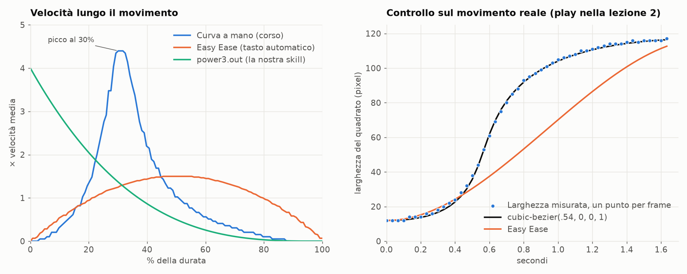

# Corso After Effects: come ragiona e quali curve usa

*Analisi del 04/11/2026 sulle registrazioni in `Videos\Architettura Mentali 2`. Trascritti e frame stanno solo in locale, in `videos/inspo-after-effects/` (corso a pagamento, fuori da git).*

## In breve

**Serve, ma per il metodo: il programma non ci riguarda.** Noi montiamo con HyperFrames, quindi metà del corso (pannelli, plugin, Animation Composer) non si trasferisce. Si trasferiscono tre cose:

1. **La curva di velocità.** È il motivo per cui i suoi movimenti sembrano fluidi, ed è diversa da tutte quelle che usa oggi la skill.
2. **Il ragionamento:** collegare gli elementi tra loro invece di animarli uno a uno, e partire sempre da un riferimento.
3. **La regola "mantieni vivo l'effetto"**, che è la tua nota "mai ferma" detta da un'altra persona.

## Video per video

Sono parti del corso "Cash Flow Contents". Legenda: **Metodo** = serve per fare motion graphics come le sue. **Altro** = non è metodo di animazione, ma si collega a qualcosa che abbiamo. **Salta** = si può ignorare.

| Video | Lezione | Di cosa parla | Valore per noi |
|---|---|---|---|
| v1 `08-15-58` | Architettura Mentale 1 | Denaro, genitori, onde cerebrali, sogni | Solo come Altro, con cautela |
| v2 `12-15-47` | AE 1 | Interfaccia e concetti base | Basso |
| v3 `12-33-52` | AE 2 | Forme, sfumature, grafico di velocità | **Il più importante** |
| v4 `13-01-11` | AE 3 | Titolo animato, collegare i livelli | Alto |
| v5 `13-49-38` | AE 4 | Shape morphing, tracciato Bézier | Alto |
| v10 `16-10-22` | AE 5 | Testo con il video dentro, testo che esce da un bordo | Medio-alto |
| v11 `16-25-02` | AE 10 | Scontorno senza green screen | Basso |
| v12 `16-31-01` | AE 11 | Montaggio completo di un video cliente, dal grezzo alla plate | **Alto, il ragionamento intero** |
| v13 `17-04-23` | Aggiornamento, camera | Videocamera 3D e oggetto Null su un foglio infinito | **Altissimo: è la nostra lavagna** |
| v14 `17-25-55` | Avanzato, 3D | Scritta 3D vera, luci, camera che entra nella scritta | Medio: titoli e intro |
| v15 `17-41-05` | AE 14 | Transizioni avanzate: continuità e flash | **Altissimo: una regola precisa** |
| v16 `17-55-55` | AE 15 | Maschere avanzate: griglia circolare, finestra sul video | Medio-alto, breve |
| v17 `18-03-02` | AE 16 (probabile) | Controlli cursore ed espressioni | Basso: da noi c'è già |
| v18 `18-17-28` | AE 17 (probabile) | Effetto di prossimità: l'ambiente reagisce a un punto | Medio-alto: un'idea nuova |
| v19 `18-33-32` | AE 18 (probabile) | Cubi in 3D classico: pezzi che si compongono in un logo | Medio-alto: una quarta curva |
| v20 `18-49-23` | AE 19 (probabile) | Testo su un tracciato che corre dentro un tubo colorato | Medio: utile per i collegamenti |
| v6 `14-20-28` | AE 6 | Motion tracking | Medio |
| v7 `14-51-15` | AE 7 | Lock-on tracking | Medio |
| v8 `15-09-55` | AE 8 | Fake 3D, griglia, espressioni, primo pezzo dell'animazione finale | **Alto** |
| v9 `15-38-21` | AE 9 | Green screen, marionetta, cilindri, ritocchi dell'animazione finale | Medio-alto |

Le code di v4 (dopo 39:00), v5 (dopo 20:30) e v7 (dopo 13:05) sono solo schermate ferme: lì non c'è nulla.

### v1: Architettura Mentale (23 min)

| Minuto | Cosa | Tipo | Collegamento |
|---|---|---|---|
| 02:14 | Elenco dei blocchi: alzare i prezzi, esporsi, metterci la faccia, "non sono pronto" | Altro | Mandal-Art (area "metterci la faccia"), prezzo del Drop 1 |
| 03:31-10:30 | Rapporto col denaro = rapporto col padre; rapporto con la madre = relazioni | Altro, cautela | Vedi sotto |
| 10:32 | La ripetizione fissa i concetti | Altro | Struttura dei copioni YouTube |
| **11:52** | **"I contenuti portano una persona da uno stato mentale A a uno stato B"**; i trigger torneranno nella scrittura | **Altro, utile** | Copione del Video #3, skill `marketing-psychology` e `copywriting` |
| 12:19-18:36 | Onde cerebrali e come "riprogrammarsi" | Salta | |
| 19:02-22:36 | Significato dei sogni | Salta | |
| **19:59** | Chi scorre il feed è già predisposto a guardare: conta l'intenzione | **Altro, utile** | Gancio dei primi secondi, nota "Virality Predictor" |

**Cautela su v1.** Qui non c'è metodo verificabile, e alcune cose vanno prese per quello che sono:

- Le "centinaia di migliaia di studi" su padre e denaro non vengono citate, e non conosco prove del genere: è un'ipotesi presentata come fatto.
- Le fasce delle onde cerebrali esistono, ma il resto non regge: il sonno REM non è sonno delta, e l'idea di "riprogrammarsi" in stato theta o di persone che entrano nei sogni altrui non ha basi scientifiche.
- È un testo di vendita applicato a chi ha già pagato: lui stesso parla di "manipolazione", screditare gli altri corsi e promettere che "non puoi non fare i soldi". Vale la pena studiarlo come esempio di persuasione, non come verità.
- L'esercizio del "funerale" al padre tocca cose personali: una lezione registrata non sostituisce un percorso vero, se sono temi che pesano.

### v2: Lezione AE 1, interfaccia (18 min)

| Minuto | Cosa | Tipo | Collegamento |
|---|---|---|---|
| 01:24-04:24 | Pannelli e confronto con Premiere | Salta | |
| **04:50** | Composizioni come scatole dentro scatole | **Metodo** | Stesso principio dei gruppi HTML in HyperFrames |
| 05:47 | Metraggi: un video come sequenza di immagini | Altro | Render a frame di HyperFrames |
| 08:53-10:13 | Tinta unita come sfondo | Salta | |
| 10:41 | Scorciatoie (A, P, S, T, R) | Solo per chi usa AE | |
| 14:20 | Annuncia roto e marionetta | Salta | |

### v3: Lezione AE 2, forme (27 min)

| Minuto | Cosa | Tipo | Collegamento |
|---|---|---|---|
| **00:30** | Perché le forme: "qualsiasi cosa è una forma"; il riferimento è lo stile dei video di Gadzhi | **Metodo** e Altro | Direzione del canale |
| 03:19 | Come cercare un effetto ragionando | Metodo | Stesso approccio per scegliere un formato |
| 02:53-06:39 | Sfondo: sfumatura radiale, poi blocca il livello | Metodo | Sfondi delle plate (`plates_base.py`) |
| 07:05-10:54 | Forma contro tracciato | Solo per chi usa AE | |
| **15:14-18:29** | **Dimensione contro scala:** la dimensione tiene fissi tratto e sfumatura, la scala ingrandisce tutto | **Metodo** | Da noi: `width` contro `transform: scale`. Spiega i bordi che ingrassano nello zoom |
| **18:54-20:40** | **Grafico di velocità** | **Metodo, il cuore** | Sezione curve qui sotto |
| 21:53-23:57 | Da quadrato a cerchio con la rotondità | Metodo | `formats/morph.py` |
| 24:35-25:16 | Trattini animati con lo scostamento | Metodo | Linee tratteggiate che si disegnano |
| 26:05 | Taglia tracciati | Metodo | Lo approfondisce in v5 |

### v4: Lezione AE 3, titolo "Cashflow Contents" (39 min)

| Minuto | Cosa | Tipo | Collegamento |
|---|---|---|---|
| 02:28-05:33 | Punto di ancoraggio e testo centrato al millimetro | Metodo | `transform-origin`: le animazioni di scala partono da lì |
| **09:59** | Due righe della stessa larghezza: "occhio grafico" | **Metodo** | Titoli, `formats/herotitle.py` |
| 12:19 | Usa sempre grassetto e maiuscole | Altro | Stile suo, non per forza nostro |
| **12:40-13:33** | "Minimo sforzo": non si anima lettera per lettera, si usa un preset | **Metodo** | Il nostro catalogo di formati |
| 14:00-23:00 | Animation Composer: scelta preset, poi toglie wiggle e rumore | Metodo come logica | Il plugin no, il "togliere" sì |
| **23:28-24:13** | **Mantieni vivo l'effetto:** scala lenta | **Metodo** | Nota "mai ferma", regola "No dead frame" in `taste.md` |
| 25:55-26:48 | Overshoot: un rimbalzo invece di due, e ritardo tra gli elementi | Metodo | Tua nota sui rimbalzi |
| **27:44-30:52** | **"Ragnatela":** gli elementi seguono il titolo | **Metodo** | Un gruppo padre nelle plate |
| 31:00-32:37 | Glitter dalla libreria | Altro | Gusto da valutare, non è il tuo stile |
| 33:02-35:16 | Ombra esterna e bagliore; bagliore minimo su rosso per effetto VHS | Altro | Look delle plate |
| 35:51-38:20 | Tasto iscriviti animato | Altro | Chiusura dei video YouTube |
| 38:40 | Con riferimento chiaro, meno di 10 minuti | Metodo | Lavorare sempre da un riferimento |

### v5: Lezione AE 4, morphing e Bézier (20 min)

| Minuto | Cosa | Tipo | Collegamento |
|---|---|---|---|
| 00:03 | Parte dal risultato finale, poi scompone | Metodo | Struttura delle prove |
| 02:41-05:00 | Sfondo a 4 colori più vignettatura: "molto più professionale" | **Metodo** | Sfondo verde delle plate: più profondità |
| **05:23-08:21** | Morphing: entrambe le forme diventano tracciati, si copia un keyframe sull'altro | **Metodo** | `formats/morph.py` |
| **08:21-10:24** | Come risolve un difetto: lo nomina, cerca il parametro | **Metodo** | Vale per ogni correzione delle bozze |
| 10:53-12:55 | Disegnare con la penna | Solo per chi usa AE | |
| **12:02** | **I loghi vanno fatti in vettoriale, così si animano** | **Altro, utile** | Logo Inverso, cartella `assets-jago`, prova "IN VERSO" |
| **13:02-15:33** | Taglia tracciati: una scia che corre lungo una linea, a goccia | **Metodo** | Linee che si disegnano; `stroke-dashoffset` in SVG |
| **16:20-19:18** | Tutto in una precomposizione, poi ombra radiale, bagliore, rotazione e scala sul blocco | **Metodo** | Il gruppo unico delle plate |
| 19:39-20:06 | Rifà rotazione e scala con le curve, sceglie il verso a gusto | Metodo | Sezione curve |

### v6: Lezione AE 6, motion tracking (15 min)

| Minuto | Cosa | Tipo | Collegamento |
|---|---|---|---|
| **00:48** | Quando serve: scritta o oggetto incollati a mano, dito, ambiente | **Altro, utile** | Formato "b-roll + scritta virale" |
| **04:10-05:07** | Si tracciano punti ad alto contrasto: il programma vede colori, non oggetti | **Metodo** | Vale per ogni tracciamento nostro |
| 05:16 | Area grande: più lento, più preciso | Solo per chi usa AE | |
| **05:57-08:42** | Oggetto Null: il movimento va su un elemento vuoto, tutto il resto lo segue | **Metodo** | Stesso principio del "maestro" di v4 |
| **08:53-10:48** | Testo a terra in 3D con ombra: copia nera, sfocata e schiacciata | **Metodo** | Si può fare anche in CSS 3D |
| 11:24-13:14 | Con zoom e rotazione servono due punti | Metodo | Clip dei reel con camera che si muove |
| **13:38-15:00** | Puntatore: linea più cerchio, disegnati con taglia tracciati | **Metodo** | Etichette delle plate; reel travel |

### v7: Lezione AE 7, lock-on tracking (13 min)

| Minuto | Cosa | Tipo | Collegamento |
|---|---|---|---|
| 00:29 | Effetto già automatico in CapCut, qui più pulito | Altro | Decisione "resta su CapCut" del passato |
| **01:40** | Sottotitoli che seguono il volto | Altro, utile | Idea per i reel, non per le plate |
| **03:27-03:41** | Stabilizza movimento: l'oggetto resta fermo e si muove il mondo | **Altro, utile** | Reel travel: inquadrature "bloccate" su un dettaglio |
| 04:28 | Se sballa un frame, si corregge a mano e non si rifà tutto | Metodo | Correggere la parte, non rifare da zero |
| **07:10** | Si sceglie la zona piena di dettagli | Metodo | Come il contrasto in v6 |
| **07:56-09:05** | Il video si sposta e scopre i bordi, quindi va ingrandito: serve più risoluzione | **Altro, utile** | `checklist-riprese.md`: girare in 4K e larghi dà margine |
| 09:44-11:18 | Scritta su un punto del soggetto che segue anche la rotazione | Metodo | Come v6 |
| 12:37 | Mostra "lo stretto necessario": ciò che si vede ogni giorno sui suoi profili | Metodo | Focus su ciò che serve |

### v8: Lezione AE 8, fake 3D (26 min)

Le ultime lezioni costruiscono un solo spot verticale: due creme, cilindri, bottone "Compra" cliccato da una mano. Ogni tecnica nasce per servire quel risultato.

| Minuto | Cosa | Tipo | Collegamento |
|---|---|---|---|
| 01:06 | Quasi tutto fatto dentro il programma: scaricati solo la crema e la freccia | Metodo | Le nostre plate sono già fatte così |
| **02:42-05:25** | Sfondo in sfumatura più griglia generata, colore vicino allo sfondo, opacità bassa | **Metodo** | È il nostro preset `plates-verde`: stessa ricetta, arrivata per altra strada |
| 03:38 | "Ci sarà un effetto che lo fa": cerca nel menu invece di inventare | Metodo | Cercare prima nel registry di HyperFrames |
| 05:38 | Tutto lo sfondo in una precomposizione, per non perderlo di vista | Metodo | Come i gruppi in `formats/board.py` |
| **07:04-09:27** | **La regola del fake 3D:** ciò che sta davanti si muove più veloce di ciò che sta dietro. Sfondo ingrandito per avere margine | **Metodo, il punto chiave** | Oggi sulla lavagna griglia e contenuto si muovono insieme: qui c'è profondità gratis |
| 10:48 | Lo sfondo parte un attimo dopo il soggetto | Metodo | Sfasare i livelli, non muoverli insieme |
| 11:48-13:58 | Tappo separato con le maschere, perno spostato sul punto giusto, rotazione | Metodo | Il punto di ancoraggio è il `transform-origin` |
| 14:12-16:25 | Crema che esce: tracciato a zigzag più taglia tracciati | Metodo | Le linee che si disegnano da sole (v3, v6) |
| **16:40-17:15** | Spostamento turbolenza: il liquido ondeggia da solo nel tempo | Metodo, da adattare | Filtro SVG, da provare: può pesare sul render |
| **17:20-19:26** | Espressione `wiggle`: tremolio continuo senza keyframe, "dà vita" | **Metodo** | "Mantieni vivo" di v4 e la nota "mai ferme". Per noi serve un tremolio uguale a ogni render |
| 19:45 | Collega tappo e liquido alla crema: si muovono tutti insieme | Metodo | La ragnatela di v4 |
| **22:49-23:06** | Posterizza tempo a 14-17 frame: movimento a scatti voluto | Altro, stile | Il contrario della fluidità che cerchi: non per le plate |
| **23:28-24:05** | Zoom su un livello di regolazione, cioè una camera su tutto. "Più ritardo all'inizio" sulla curva | **Metodo** | La nostra camera: vedi la curva qui sotto |
| 24:24 | Cambio colore dello sfondo sincronizzato col livello madre | Metodo | Il colore cambia su un evento del racconto |
| 26:14 | Le creme crescono più dello sfondo: sembrano uscire dallo schermo | Metodo | Il fake 3D funziona anche con la scala |

### v9: Lezione AE 9, marionetta e chiusura dello spot (31 min)

| Minuto | Cosa | Tipo | Collegamento |
|---|---|---|---|
| 01:23-03:17 | Green screen con Keylight, perché verde e non rosso: la pelle ha il rosso | Altro | Se mai gireremo su green screen |
| 03:42-07:24 | Blocca fotogramma, ordine inverso, dilatazione del tempo | Altro | Lo facciamo già con ffmpeg |
| **09:09-12:21** | Marionetta: un perno che non muovi tiene fermo il punto. Un perno per ogni osso | Salta per noi, idea utile | Solo After Effects. L'idea resta: fissa ciò che non deve muoversi |
| **14:02-16:29** | Cilindro finto: ellisse sopra, rettangolo sotto, sfumature. Niente 3D | **Metodo** | Rifattibile con le sfumature in CSS |
| **17:04-18:29** | Ombre dirette verso l'oggetto dietro, per dare profondità. "Spingi i parametri per capire cosa fanno" | Metodo | Stessa logica del fake 3D |
| **19:08-20:00** | Niente precomposizione: i cilindri devono partire sfalsati | **Metodo** | Raggruppa solo ciò che si muove insieme |
| 20:43-21:14 | Il bordo del bottone è la versione più chiara del suo colore | Metodo | Dettaglio per le card delle plate |
| **22:21-22:52** | Bottone collegato al cilindro principale, scelto provando e guardando | **Metodo** | Il filo del corso: un elemento porta il movimento |
| 23:13 | Il bottone compare dopo, così non resta lì sopra da subito | Metodo | L'elemento entra sulla parola |
| 23:33-24:19 | Light sweep: una luce passa sul bottone | Metodo, da adattare | Una sfumatura che scorre: si rifà facilmente |
| **24:44-27:50** | Turbolenza su tutto come onda di passaggio. Dice che è ricercatissima: è una sua opinione | Metodo, da adattare | Possibile transizione, solo dopo una prova |
| 28:22 | Prima costruisce la mano, poi la porta nello spot | Metodo | Pezzi separati, poi assemblati |
| **28:47-30:03** | Bottone premuto: scala 90, 93, 110 sul clic | Da evitare sulle plate | È il rimbalzo che hai bocciato il 04/11. Ha senso solo su un clic vero |

### v10: Lezione AE 5, maschere e testi (14 min)

Registrata per ultima: nel corso viene tra v5 e v6.

| Minuto | Cosa | Tipo | Collegamento |
|---|---|---|---|
| **00:30-05:47** | Video dentro le lettere della scritta: testo sopra la clip, modalità alfa stencil | **Metodo** | Rifattibile: `background-clip:text` o maschera in CSS. Adatto a una parola chiave, oppure ai reel |
| 01:53-02:47 | Esporta i pezzi finiti e lavora in parallelo: i progetti enormi pesano e non escono | Metodo | Le nostre finestre di prova e i `window-patch` |
| 03:38-04:28 | Ripasso del "collega a" (ragnatela) e delle modalità di fusione | Metodo | v4 |
| 06:12 | Il testo resta modificabile finché non diventa immagine | Metodo | Da noi il testo è già HTML: si cambia sempre |
| **06:46-11:25** | Testo che esce da sotto un bordo invisibile: forma sopra, modalità alfa sagoma | **Metodo** | Il classico ingresso dei titoli. Da noi: testo che sale dentro un contenitore con `overflow:hidden` |
| 08:11-10:14 | Con un livello selezionato il rettangolo crea una maschera, senza livello crea una forma | Salta | Solo After Effects |
| 09:07-09:43 | Lettera per lettera con le maschere: lui stesso dice che è lento | Salta | Da noi basta separare le lettere |
| 11:43 | Differenza tra alfa e luma: la spiega "detto facile", in modo approssimativo | Salta | Non è un riferimento tecnico |
| 12:13-13:16 | Maschera disegnata con il tracciato Bézier | Metodo | v5 |

### v11: Lezione AE 10, fake green screen (5 min)

| Minuto | Cosa | Tipo | Collegamento |
|---|---|---|---|
| 00:28-01:13 | Roto Bézier: si pennella il soggetto da tenere, il resto sparisce | Altro | Solo After Effects. Da noi servirebbe uno scontorno video |
| 01:13-01:41 | Funziona per pochi secondi su video grezzi; per un video intero meglio il green screen vero | Altro | Limite dichiarato da lui |
| 03:05 | Esporta il pezzo scontornato prima di aggiungere altro, se no il computer non regge | Metodo | Come v10 e i nostri `window-patch` |
| **04:10-04:37** | Te scontornato sopra te vero: scritte e forme finiscono **dietro** la persona | **Metodo, da adattare** | Testo tra Jacopo e lo sfondo: effetto forte, da usare in contesti scelti |

### v12: Lezione AE 11, come ragiona su un video vero (31 min)

Chiude la parte tecnica e apre il modulo sugli short. Monta un video verticale da zero e improvvisa: è la lezione che mette insieme tutte le altre.

| Minuto | Cosa | Tipo | Collegamento |
|---|---|---|---|
| 00:57-01:50 | Video iPhone troppo luminoso: si cambia lo spazio colore di lavoro, non l'esposizione | Altro, utile | Il nostro D-Log → 709: prima il tag giusto, poi il colore |
| 01:50-03:08 | Ordine: prima la correzione colore, poi l'inquadratura, poi i tagli | Metodo | La nostra pipeline |
| 03:31 | Occhi sempre alla stessa altezza | Metodo | Da controllare sulla faccia in PiP |
| 04:10-07:33 | Taglia ascoltando, fino a far sentire tutte le lettere | Metodo | Le nostre regole di taglio |
| **07:34** | Dice che lavora a 60 frame al secondo | **Metodo, da verificare** | Noi siamo a 30: con la curva il passo dello swipe si dimezzerebbe. La registrazione è a 30, quindi sul video non si può controllare |
| 07:45-07:49 | Livello di regolazione con scala sopra la clip: la camera si muove anche sulla faccia | Metodo | Il nostro zoom sulla faccia |
| 07:58-08:45 | Non sai cosa animare? Metti un B-roll di quello che dice | Metodo | La nostra regola B-roll |
| 08:45-09:11 | I primi 5 secondi sono l'hook: rimanda al modulo successivo | Altro | Virality Predictor: leva sui primi 15 secondi |
| **09:11-09:40** | **"Sono questi quattro step": se lo dice, devi farli vedere.** La plate nasce dalla frase | **Metodo, il punto chiave** | Stessa regola di Joseph: la plate sulla parola che la nomina |
| 10:08-11:23 | Sfondo sfumatura più griglia, titolo, bagliore: lo fai una volta e lo copi su tutto | Metodo | Il preset è questo |
| 13:52 | "Sto improvvisando": niente progetto prima | Metodo | Scene improvvisate, nota del 01/11 |
| 15:09-16:32 | Il numero enorme dietro, la parola davanti, fusi con una modalità | **Metodo** | Gerarchia: numero grande e testo sopra. Provabile con `mix-blend-mode` |
| 17:24-17:51 | Prima di copiare un gruppo, tira fuori il contenuto: se no cambiano tutte le copie | Salta | Solo After Effects |
| 18:19 | Cambia colore a ogni copia con un solo effetto | Metodo | Per noi basta una variabile CSS |
| **19:46-20:12** | Il testo vero non serve: lorem ipsum e mosaico, per creare curiosità | **Metodo, da decidere** | Nascondere gli step finché non li dice |
| **21:03-21:49** | Ogni pallina collegata al suo testo, timeline pulita: "si lavora così" | **Metodo** | Il filo del corso |
| **24:25** | Gioca con i tempi: elementi sfalsati a scala | **Metodo** | Sulla timeline si vede una scaletta precisa |
| 24:46-25:19 | Wiggle su tutto e posterizza: il suo stile short | Altro, stile | Non per le nostre plate |
| **26:12-27:34** | Scala finale sul livello di regolazione, con la curva a picco | **Metodo** | Nel grafico si vede la stessa famiglia, a occhio |
| **28:11-28:49** | Niente "mortume" tra le clip: la transizione sta **a cavallo** del taglio | **Metodo** | Plate che entra prima che finisca la frase |
| **29:27-30:20** | Sound design: un clic per ogni elemento, abbassa il tono di 10 per dargli peso | **Metodo, da sentire** | Tu non vuoi i pop: va provato solo con suoni scelti da te. Il tono cambiato è un'idea nuova |

### v13: Aggiornamento, videocamera e movimento 3D (21 min)

Apre una parte nuova del corso, più avanzata. Testo su sfondo chiaro, nessuna grafica: conta solo il movimento. È il caso più vicino alla nostra lavagna.

| Minuto | Cosa | Tipo | Collegamento |
|---|---|---|---|
| 01:36-02:01 | Costruisce sull'audio e pensa solo al movimento, non alla grafica | Metodo | Provare il movimento prima di rifinire |
| **03:52-04:18** | La camera è meglio del livello di regolazione: "infinito foglio bianco" dove metti tutto | **Metodo, il punto chiave** | È `formats/board.py`, arrivato da solo alla stessa idea |
| **04:45-05:37** | Lo sfondo resta fuori dal 3D, quindi non finisce mai. La griglia invece finisce | **Metodo** | Sfondo fermo, si muove solo il contenuto |
| 06:03-06:58 | Camera comandata da un Null, anche un parametro alla volta | Metodo | Un contenitore in più in HTML |
| 07:27-08:46 | Senza Null è più veloce ma scomodo: l'orientamento è sensibile e deforma | Salta | Solo After Effects |
| 09:08-09:35 | Pochi preset con la stellina, gli altri non li guarda | Metodo | Poche curve fisse nella skill |
| 09:35 | Preset "overshoot 3D" | Da evitare | Rimbalzo |
| **10:06-10:36** | Spazio vuoto intorno all'unica scritta: effetto premium, attenzione sul centro | **Metodo** | Meno elementi per plate, nota del 04/11 |
| **10:59-12:09** | **Correzione del suo stesso metodo:** prima usava 4 keyframe, ora 3, muovendo insieme posizione e orientamento | **Metodo, il punto chiave** | Un solo gesto invece di due mosse |
| **12:35-13:31** | Grafico: la mossa d'ingresso parte già al massimo, "sul muro", e rallenta. La seconda è una cupola. "Mai troppo piatta", se no scatta | **Metodo** | Vedi la curva qui sotto |
| 14:09-15:05 | Tiene la griglia per mostrare quanto stona, prova la sfocatura di camera, poi toglie tutto | **Metodo** | Prova e togli. Da confrontare con la nostra griglia |
| **15:09-15:49** | Zoom sul testo col Null, separato dalla camera | Metodo | Zoom e spostamento su due contenitori diversi |
| 16:38 | "Pezzettino dopo pezzettino", riascoltando ogni volta la voce | Metodo | Il nostro metodo a finestre |
| **17:03-17:59** | La frase si accumula, la parola nuova entra rossa e l'occhio va lì | **Metodo** | Il nostro oro sulla parola chiave |
| **18:21-18:47** | Niente sfondo e niente griglia: è bello perché il movimento è buono e il testo pulito | **Metodo** | Il valore sta nel movimento, non nella decorazione |
| 19:26 | Anche su una foto: meglio la camera 3D che la sola scala | **Metodo** | Il moodboard del Video #3 |

Cita lezioni che non abbiamo: "tecniche di manipolazione visiva" e la "regola del box" per i testi. Annuncia le "transizioni avanzate".

### v14: Modulo avanzato, 3D avanzato (15 min)

Titolo cinematografico, rosso su nero, in formato orizzontale. Serve per intro e titoli, non per le plate di spiegazione. Negli ultimi frame si vede che la lezione dopo è la 14, "Transizioni Avanzate": quindi v13 e v14 sono probabilmente la 12 e la 13. L'ha poi confermato v15, che è la 14.

| Minuto | Cosa | Tipo | Collegamento |
|---|---|---|---|
| 00:55 | Dice che After Effects potrà sostituire un po' Blender | Altro | Opinione sua |
| 01:25 | Formato orizzontale e sfondo nero per un risultato "cinematico" | Metodo | Il nostro 16:9 |
| 02:31-03:26 | Due strade: plugin Element 3D a pagamento, o 3D avanzato incluso | Salta | Solo After Effects |
| **03:26-04:42** | Col 3D gli effetti non funzionano sul livello: il bagliore va su un livello di regolazione sopra | Metodo | Separare forma ed effetti |
| 04:42 | Esporta con la trasparenza e lavora poi solo sul testo | Metodo | Pezzi separati, come v10 e v11 |
| **05:10-06:21** | Estrusione e smusso: lo spessore della scritta | Metodo, da adattare | In HTML: strati di testo o il 3D del registry |
| **07:54-09:29** | Senza una luce scelta da te il risultato è casuale. Consiglia il faretto: illumina solo una parte | **Metodo** | Scelta valida anche in 2D: un alone che illumina il titolo |
| 10:06-10:18 | La luce si anima: il movimento è nella luce, non nel testo | **Metodo** | La scena vive anche se il testo è fermo: nota "mai ferme" |
| 10:38-11:06 | Anche foto, forme e file vettoriali possono avere spessore | Altro | Logo in 3D, se servirà |
| **11:36-11:45** | Animatore testo: la spaziatura si stringe fino a comporre la scritta. "Molto figo" | **Metodo** | Facile: `letter-spacing` con la nostra curva |
| **11:45-12:45** | Camera che parte dentro la scritta e arretra | **Metodo, da adattare** | Ingresso per intro e capitoli |
| **12:52-13:09** | "Prendo la palla al balzo": la luce va a destra, e la scritta sparisce seguendola | **Metodo** | La transizione nasce da un movimento che c'è già. Come "a cavallo del taglio" di v12 |

### v15: Lezione AE 14, transizioni avanzate (14 min)

Tesi: servono solo due transizioni, continuità e flash. Il resto distrae.

| Minuto | Cosa | Tipo | Collegamento |
|---|---|---|---|
| **00:34-01:18** | Le transizioni piene di roba piacciono ai nerd. Pensa a un cinquantenne: capisce o no? | **Metodo** | Ogni plate ha una funzione, come in Joseph |
| 01:18-01:46 | Le uniche due: continuità (o movimento) e flash | **Metodo** | Sostituisce un catalogo di transizioni |
| **02:11** | Ordine: animazioni sulla sola voce, poi suono e musica alla fine | **Metodo** | Così il suono cade esattamente sulla transizione |
| **02:38-03:07** | Continuità: la scena dopo prosegue il movimento di quella prima | **Metodo, il punto chiave** | Lo swipe tra due plate è già questo |
| 03:21-06:51 | Versione semplice: una camera spara fuori, taglio, la seconda entra con la stessa velocità | Metodo | Due mosse che si incontrano |
| 06:20 | "Risulta stonata perché è troppo lenta" | Metodo | Le transizioni vogliono velocità, a differenza delle mosse di camera |
| 07:18 | Si può anche far entrare la scena dal lato opposto | Metodo | Variante |
| **07:18-07:45** | Regola: cambiare qualcosa ogni 5 secondi circa. È una sua regola, senza dati | Metodo, da tenere d'occhio | La tua nota "mai ferme" |
| **07:56-08:21** | Colori invertiti da un taglio in poi: cambia il mood con un solo effetto | **Metodo** | Il cambio di tono su una frase forte |
| **09:30-10:46** | **La regola più utile:** una sola mossa col Null, e la massima velocità cade esattamente sul cambio di scena | **Metodo, il punto chiave** | Il taglio si nasconde nel picco. Vedi la curva qui sotto |
| **10:46-11:27** | Flash: solido bianco sul taglio, opacità dal massimo a zero | **Metodo** | Facilissimo da rifare |
| **11:27** | "Light leak e overlay bruciati sono passati di moda, fanno schifo" | Opinione da valutare | Deciso il 04/11: teniamo sia i flash sia i light leak |
| 11:27-13:04 | Scena che va indietro, solido del colore dello sfondo, dissolvenza | Metodo | Uscita pulita |

Il corso si contraddice: in v9 chiamava "oro" l'onda di turbolenza dei creator famosi, qui critica quegli stessi stili. Conta il principio di questa lezione, che è il più recente.

La prossima lezione è la 15, "Maschere Avanzate: Precisione, Effetti e Compositing da Pro".

### v16: Lezione AE 15, maschere avanzate (7 min)

Promette tre usi, animazioni, tracciamento e bordi, e li mostra in fretta.

| Minuto | Cosa | Tipo | Collegamento |
|---|---|---|---|
| **01:09-02:53** | Griglia circolare inclinata: griglia, maschera rotonda sfumata, rotazione in 3D. "L'unico modo in cui apprezzo la griglia" | **Metodo** | Risponde alla domanda aperta dalla lezione sulla camera: la griglia non a tutto schermo, ma come macchia sfumata. Rifattibile in CSS |
| 01:35-02:27 | La griglia non accetta maschere finché non è in una precomposizione | Salta | Solo After Effects |
| **03:20-03:51** | Maschera come lente: la finestra si muove, il contenuto resta fermo sotto | **Metodo** | Un riquadro che scorre e scopre parti di un'immagine |
| **03:51-05:03** | Maschera che si porta dietro il contenuto: il video in una card arrotondata che si apre | **Metodo** | Lo facciamo già con `clipPath` su `#video-wrap` all'apertura delle plate |
| 05:03-05:32 | Essendo una forma, puoi animare gli angoli e aggiungere un bordo tratteggiato | Metodo | Dettaglio per le card |
| 05:32-06:16 | Maschera sull'orecchio che segue il soggetto: più punti, più precisione | Salta per noi | Solo After Effects |

### v17: Lezione AE 16, controlli cursore ed espressioni (14 min)

Lui la presenta come molto difficile. Per noi è la più facile: è il modo in cui After Effects imita quello che il codice fa già. Il numero 16 è dedotto: la pagina a fine video mostra la 17 come successiva.

| Minuto | Cosa | Tipo | Collegamento |
|---|---|---|---|
| **00:29** | Un solo cursore comanda tanti parametri, tenuto su un Null: un centro di controllo | **Metodo, già nostro** | Le costanti in cima a `formats/board.py` (`PUSH`, `SWIPE`) e i preset |
| 03:09-05:01 | Opacità e colore collegati a un controllo | Salta | In CSS sono le variabili |
| 05:24-08:31 | Posizione: un cursore per asse, con variabili e parentesi quadre | Salta | Sintassi di After Effects |
| 08:58-12:22 | Stessa cosa su tre assi: un cubo che diventa parallelepipedo | Salta | Il cubo arriva nelle prossime lezioni |
| 11:23 | Il cursore si ferma a 100: si cambia l'intervallo | Salta | Solo After Effects |

Nessuna prova nuova. Il parlato finisce a 12:41 mentre sta per mostrare un'altra cosa, poi la registrazione continua per circa un minuto: forse manca un pezzo.

### v18: Lezione AE 17, effetto di prossimità (16 min)

Un punto luce si muove nella scena e tutto ciò che ha vicino reagisce: le sfere scappano e si illuminano dal lato giusto. È tutto 2D. Il numero 17 viene dal titolo visto a fine v17. La lezione è completa, stavolta si chiude a 15:20.

| Minuto | Cosa | Tipo | Collegamento |
|---|---|---|---|
| **00:05-01:50** | L'idea: l'ambiente risponde a un punto. Lui la vede come base per personaggi e cartoni | **Metodo** | Nuova per noi: oggi sulle plate ogni elemento si muove per conto suo, nessuno reagisce agli altri |
| 02:42-03:25 | Un Null che si muove, più un Controller con due cursori: distanza massima e forza | **Metodo** | Due soli numeri comandano tutto, come in v17. Nel codice è una formula sulla distanza tra due punti |
| 03:55-05:39 | Errori perché i nomi nell'espressione devono combaciare, e After Effects in italiano dice "cursore" | Salta | Solo After Effects |
| **07:51-08:12** | Consiglio: poca forza e distanza molto alta, così il movimento è morbido | **Metodo** | La reazione si sente su tutta la scena invece di scattare da vicino. Va d'accordo con la regola "niente rimbalzo" |
| **09:04-11:49** | Ombra interna usata come luce: l'angolo segue il punto, l'opacità cala con la distanza | **Metodo** | Bordo luminoso che gira attorno a una card. Rifattibile in CSS. Parente del light sweep di L9 |
| 11:54-12:31 | Copia lo stile su tutte le sfere | Salta | Nel codice è una classe |
| 12:36-13:29 | Il punto luce è una sferetta bianca con bagliore, legata al Null | Metodo | Facile da rifare |
| **13:37-14:06** | Bagliore e vignettatura su un livello di regolazione bloccato in cima | **Metodo** | Stesso trucco di L14 e v14: il finish sta sopra a tutto e non intralcia |
| 14:52-15:18 | Cambio di colore di tutta la scena con un solo effetto | Metodo, già nostro | Le variabili colore dei preset |

Le espressioni sono un file del corso: qui si vede il risultato, non il codice completo. A noi non serve, la formula si riscrive.

Il rischio per le plate: il movimento nasce da una formula, quindi va calcolato frame per frame in modo che esca uguale a ogni render. Serve anche una ragione per il punto che si muove, altrimenti resta una demo.

### v19: Lezione AE 18, cubi in 3D classico e logo che si compone (16 min)

Quattro mattonelle arrivano da punti diversi e si chiudono in una finestra, ispirata a Windows, poi esplode la luce. Il cubo è il "bello cubo" annunciato in v17. Il numero 18 è dedotto dall'ordine: nel video non è scritto. La lezione è completa.

| Minuto | Cosa | Tipo | Collegamento |
|---|---|---|---|
| **00:27** | Tutto in 3D classico, senza estrusione e senza plugin | **Metodo** | Risponde al limite di v14: il 3D avanzato non accetta effetti, quello classico sì |
| **01:26-04:48** | Il cubo si costruisce come un origami: sei facce piatte, ruotate e accostate | **Metodo** | In CSS si fa allo stesso modo, con sei `div` e `transform` in 3D. Niente Blender |
| 04:26 | "Non è precisissimo, tanto non si vede" | Metodo | Stessa logica di L11: conta quello che arriva all'occhio |
| 05:48-07:02 | Precomposizione col 3D mantenuto, punto di ancoraggio al centro del cubo | Salta | In CSS è il `transform-origin`, il principio è lo stesso: si ruota attorno al centro |
| 07:39-08:24 | Il cubo schiacciato diventa una mattonella, quattro copie fanno la finestra | **Metodo** | Un solo pezzo riusato: è il "maestro" di L3 e L9 |
| **08:43-09:57** | Si parte dalla posizione finale e si smonta: ogni pezzo va via e ruota, uno resta al centro | **Metodo, il cuore** | Si anima al contrario, così la forma finale è sicuramente giusta. Vale per qualsiasi cosa si componga |
| **10:41-11:11** | Curva dei pezzi: lenti all'inizio, veloci alla fine | **Metodo** | Quarta curva, vedi sezione sotto |
| **11:23-12:47** | La camera fa la mossa vera quando i pezzi si chiudono. Prova varie versioni, ne boccia due: "più siamo semplici, meglio è" | **Metodo** | Due mosse sincronizzate su un solo istante. Conferma la tua regola: meno, ma giusto |
| **12:47-14:35** | Bagliore su un livello di regolazione, raggi di luce su un altro, con l'opacità che sale solo quando tutto si compone | **Metodo** | Il finish non è fisso: arriva con l'evento. Si lega allo strato di L17 |
| 14:35-15:15 | Light Burst attorno all'oggetto | Metodo | Da usare poco, va vicino al look "effetto" che lui stesso critica in L14 |

Colori magenta e blu su nero: sono i suoi, non la nostra direzione.

### v20: Lezione AE 19, testo su tracciato e "effetto elastico" (8 min)

La scritta scorre lungo una linea curva e un tubo colorato la segue: se la linea si deforma, si deformano entrambi. Viene da un suo video. Il numero 19 è dedotto dall'ordine. Dice che siamo alle "ultime lezioni" del capitolo. La lezione è completa.

| Minuto | Cosa | Tipo | Collegamento |
|---|---|---|---|
| **00:46-01:47** | Testo su tracciato: si disegna una maschera e il testo la segue | **Metodo** | In SVG è `textPath`, si fa senza fatica |
| **02:03-03:37** | Forma e maschera collegate: una sola linea comanda testo e tubo | **Metodo** | Il "centro di controllo" di v17: una sola curva nel codice, usata due volte |
| 03:57-04:11 | Il tubo prende una sfumatura dal rosso al viola | Metodo | Da noi sarebbe nei colori del preset |
| **04:13-04:37** | Il testo scorre spostando il primo margine | **Metodo** | In SVG è `startOffset`. Curva: vedi sezione sotto |
| **04:37-05:45** | Il tubo si disegna insieme al testo con "taglia tracciati" | **Metodo** | Lo stesso disegno progressivo delle linee, in SVG con `stroke-dashoffset`. Vale la regola già tua: il tratto parte dopo i due elementi che collega |
| 04:54 e 06:41 | Zigzag sul tubo, poi lo toglie perché non combacia col testo | Salta | Lui stesso lo scarta |
| 05:45-06:12 | Livello 3D e camera che ruota attorno | Metodo | Già visto in v13 |
| **06:31** | Sfocatura di movimento attivata prima del finale | **Metodo** | Vedi la prova in lista |
| 06:54-07:57 | Preset di Animation Composer con overshoot sul testo, poi bagliore | Salta | Plugin, e l'overshoot è il rimbalzo che non vuoi |

Per le plate il pezzo buono non è l'effetto a tubo, che è molto suo. È la parola che viaggia sulla linea che collega due concetti.

### Il filo che lega i video

1. **Una gerarchia, non tanti oggetti:** scatole (v2), ragnatela (v4), precomposizione (v5), oggetto Null (v6) sono la stessa idea detta quattro volte. Un elemento porta il movimento, gli altri lo seguono.
2. **Linee che si disegnano:** trattini (v3), taglia tracciati (v5), puntatore (v6). Ci serve per le tue note sui tratteggi.
3. **Profondità dello sfondo:** sfumatura radiale (v3-v4), 4 colori più vignettatura (v5), ombra a terra (v6).
4. **Risolvere per nome:** in tutte le lezioni nomina il difetto prima di toccare qualcosa. È anche il modo migliore per darmi note sulle bozze.

## La curva di velocità

Il suo processo, nella lezione sulle forme (v3):

1. Parte da due keyframe lineari: velocità costante, 235,69 unità/sec, poi si ferma di colpo. Lui lo dice: "si arresta molto bruscamente".
2. Apre l'editor grafico in modalità **grafico velocità**.
3. Porta a zero la velocità di entrambi i keyframe. Oppure usa il tasto automatico, "con la metà del tempo".
4. Il tasto automatico però non gli basta: **lavora a mano sulle maniglie** fino a stringere la curva in un picco alto e spostato a sinistra.

Ho digitalizzato le curve pixel per pixel:

| Curva | Equivalente | Picco (× media) | Dove cade il picco | Metà strada | 90% della strada |
|---|---|---|---|---|---|
| Tasto automatico | `cubic-bezier(.33, 0, .67, 1)` | 1,5 | circa a metà | 50% del tempo | 81% |
| **A mano, quadrato (v3)** | **`cubic-bezier(.54, 0, 0, 1)`** | **4,4** | **30%** | **33%** | **55%** |
| A mano, scala (v5) | circa `cubic-bezier(.48, 0, 0, 1)` | 4,7 | 26% | 31% | 51% |
| `power3.inOut` (skill) | | 4,0 | 50% | 50% | 67% |
| `power3.out` (skill) | | 4,0 | 0% | 16% | 44% |
| `power2.inOut` (skill) | | 3,0 | 50% | 50% | 71% |

Correzione del 04/11: picco e percentuali della riga "A mano, quadrato" sono misurati sulla curva disegnata. La formula `cubic-bezier(.54, 0, 0, 1)` calcolata da sola ha un picco un po' più alto: 5,1 volte la media, al 30% della durata, con il 90% della strada al 57%. La forma è la stessa, ma per il passo in pixel vale il 5,1.

**Nuovo dalla Lezione 8 (min 24:01):** lo zoom di camera ha la stessa famiglia di curva, ma con il picco più avanti, circa al 40%, e dura circa 2 secondi. Valori letti a occhio sul grafico, non digitalizzati. Prima dello scatto c'è una rincorsa più lunga, ed è il "più ritardo all'inizio" che dice lui. Nella stessa lezione (min 16:26) sulla crema che esce si vede una curva simmetrica, ma è proprio il momento in cui dice di voler cambiare la velocità: non sappiamo se la lascia così.

**Nuovo dall'aggiornamento sulla camera (v13, min 12:51):** qui il grafico è diverso dal picco stretto. Nella mossa d'ingresso la velocità parte al massimo e cala; nella seconda è una cupola larga, a zero solo agli estremi. Letto a occhio, non digitalizzato. Quindi la curva a picco non è l'unica: la scelta dipende dalla mossa. Sugli swipe resta la D, che ti è piaciuta a occhio; la cupola va confrontata.

**Nuovo dalla Lezione 14 (min 12:30):** la curva della transizione è un picco strettissimo, quasi simmetrico, con il massimo circa al 47% della durata e code lunghe e morbide. Tocca 20.000 px al secondo: in quel momento non si legge nulla, e lì sta il taglio. Valori letti a occhio. Abbiamo quindi tre famiglie: **picco in anticipo** per le mosse di scena, **cupola** per la camera che si sposta, **picco centrale stretto** per le transizioni.

**Nuovo dalla Lezione 18 (circa min 11):** due curve nella stessa mossa. I pezzi hanno il **picco in ritardo**: accelerano e si fermano di colpo, con il massimo circa all'85% della durata. La camera ha un picco stretto circa al 40% e una coda lunga, la stessa famiglia dello zoom di L8. Valori letti a occhio su frame sfocati. Le famiglie diventano quattro: la nuova serve quando dei pezzi si chiudono su qualcosa. L'arresto secco va provato con attenzione, perché può sembrare il colpo che non ti piace.

**Nuovo dalla Lezione 19 (circa min 4:30):** nel grafico visibile la velocità sale subito, con il massimo circa al 20% della durata, e poi scende in una coda lunga. La cima è tagliata dallo schermo e la proprietà non si legge bene: probabilmente è il testo che scorre. Letto a occhio. È la stessa famiglia del picco in anticipo, come la rotazione finale di v5.

**Cosa significa, a parole:** il movimento parte piano per un attimo, scatta forte intorno al 30% della durata, poi passa quasi metà del tempo ad assestarsi sull'ultimo 10% di strada. Prima lo stacco, poi la planata.

Nessuna curva della skill ha questa forma. Le `inOut` sono simmetriche, con il picco a metà. Le `.out` partono già al massimo, senza alcuna rincorsa.

**Quanto sono affidabili questi numeri:**

- Digitalizzando il tasto automatico esce `.331 / .672`, cioè il valore noto dell'Easy Ease (33%): il metodo legge giusto.
- Il tooltip conferma la velocità lineare: 436 ÷ 1,85 s = 235,7 unità/sec.
- Misurando il quadrato frame per frame mentre va in play, la curva a mano sbaglia di circa 1 pixel su 105. L'Easy Ease sbaglia di 11.

**Altre curve viste, stimate a occhio:**

- **Rotazione finale (v5):** stessa famiglia ma più estrema, picco intorno al 20%.
- **Morphing quadrato → asterisco (v5):** prima campana simmetrica, poi spostata a sinistra.

Spiega il grafico di velocità in un solo passaggio esteso e non dà mai numeri: lavora a occhio. I valori qui sopra sono quello che la sua mano ha prodotto in due esempi, non una regola dichiarata da lui.

## Il ragionamento dietro

- **Parte dal risultato.** Ogni lezione apre con l'effetto finito, poi lo scompone. Dice che con idea e riferimento chiari un lavoro da 40 minuti di lezione ne richiede meno di 10.
- **Cerca gli effetti per logica:** "che tipo di cosa è?" (si genera? allora sta in Genera), non a memoria.
- **Davanti a un difetto, prima lo nomina.** Nel morphing: "sono le punte che sporgono", quindi cerca dove si controllano le punte. Si risolve in un parametro.
- **Automatizza ciò che non si vede:** "minimo sforzo, massimi soldi". Il testo lettera per lettera lo fa fare al preset, poi lo corregge togliendo.
- **Toglie il rumore dai preset.** Azzera il wiggle perché il default è "confusionario", riduce la rotazione, passa i rimbalzi da 2 a 1: "molto più pulita". È la tua stessa nota sui rimbalzi.
- **Un maestro, gli altri seguono.** Con la "ragnatela" (imparentamento) i cubi seguono il testo senza keyframe propri: si muovono insieme e, se cambia il tempo, cambia tutto. Scalare ogni elemento per conto suo dà un risultato diverso, perché ognuno scala dal proprio centro.
- **Mantieni vivo l'effetto.** Quando l'animazione si ferma "non è bello": aggiunge una scala lenta sotto tutto (nel testo parte da 107%; il valore d'arrivo nel video non si legge bene). Lo consiglia anche nel montaggio, quando un video "non ti cattura".
- **Una precomposizione raggruppa, poi si anima il gruppo.** Morphing e tracciato finiscono in un solo blocco: bagliore, rotazione e scala vanno sul blocco intero. Così il movimento finale è uno solo, non tanti.
- **Spinge i parametri al massimo per capirli**, poi torna indietro.

## Prove da fare a fine corso

Deciso il 04/11: si fanno tutte insieme quando il corso è finito, ognuna su una finestra corta del Video #3 prima di propagarla. Questa lista si aggiorna a ogni nuova lezione.

**Già scelta, da applicare**

- [ ] **Curva sugli swipe:** `cubic-bezier(.54, 0, 0, 1)` a 1,3 s in `formats/board.py`, con il suono anticipato sul picco, a 0,39 s dall'inizio. Il codice oggi passa la curva come nome tra virgolette: serve un piccolo ritocco. Va rifatta la prova vera in HyperFrames.

**Movimento**

- [ ] **Profondità sulla lavagna (fake 3D, L8):** durante lo swipe la griglia si muove meno del contenuto.
- [ ] **Curva sulla camera (L8):** stessa famiglia con picco al 40% circa, contro `power2.inOut`, su uno zoom vero. Prima va misurata sul grafico.
- [ ] **Curva a cupola contro curva D (v13):** stesso swipe, per capire quale regge meglio una camera.
- [ ] **Un solo gesto con leggera rotazione (v13):** posizione e orientamento insieme, 3 keyframe invece di 4.
- [ ] **Sfondo fermo senza griglia (v13):** contro la griglia di oggi e contro il fake 3D.
- [ ] **Frase che si accumula e camera che arretra (v13):** la parola nuova entra colorata.
- [ ] **Scala lenta unica su tutta la plate (L3):** continua dopo l'ultimo elemento, per la regola "mai ferma".
- [ ] **Tremolio leggero sugli elementi (`wiggle`, L8):** deve uscire uguale a ogni render e restare appena percepibile.
- [ ] **Un maestro per plate (L3, L9):** gli elementi seguono un gruppo che fa il movimento principale, con partenze sfalsate.

- [ ] **60 frame al secondo (L11):** stesso swipe a 30 e a 60 fps. Il render costa il doppio, va capito se si vede.
- [ ] **Sfocatura di movimento (L19):** stesso swipe con e senza. Va capito come ottenerla in HyperFrames e quanto pesa sul render.
- [ ] **Transizione a cavallo del taglio (L11):** la plate entra prima che finisca la frase.

- [ ] **Transizione col taglio nel picco (L14):** una sola mossa, picco stretto, cambio di plate sul massimo.
- [ ] **Flash bianco contro light leak (L14):** uno contro l'altro sulla stessa transizione del Video #3. Restano disponibili entrambi.
- [ ] **Colori invertiti su una frase forte (L14):** cambio di mood, da usare poco.

**Testi**

- [ ] **Testo che esce da un bordo invisibile (L5):** per i titoli delle plate.
- [ ] **Video dentro le lettere (L5):** su una parola chiave, o in un reel.
- [ ] **Numero enorme dietro, parola davanti (L11):** per i capitoli e gli elenchi.
- [ ] **Testo nascosto col mosaico (L11):** gli step coperti finché non li dici.
- [ ] **Scritte dietro la testa (L10):** a Jacopo piace se fatta bene, in alcuni contesti. Pochi secondi, scontorno pulito, momento scelto.

- [ ] **Spaziatura che si stringe (v14):** titolo che si compone, con la curva scelta.
- [ ] **Parola che viaggia su una linea (L19):** la linea si disegna tra due concetti e la parola ci corre sopra, con la curva scelta.
- [ ] **Scritta 3D con spessore (v14):** per l'intro, rosso o oro su nero.

**Abbellimenti**

- [ ] **Luce che scopre il titolo e fa da transizione (v14):** la scritta sparisce seguendo la luce.
- [ ] **Camera che parte dentro la scritta e arretra (v14):** per intro e capitoli.
- [ ] **Griglia circolare inclinata (L15):** griglia solo in una macchia sfumata, contro la griglia intera di oggi.
- [ ] **Maschera a lente (L15):** una finestra che scorre e scopre un'immagine, per il moodboard.
- [ ] **Light sweep (L9):** una luce che passa su una card o un bottone.
- [ ] **Prossimità (L17):** un punto attraversa la plate e gli elementi vicini si scostano piano, con poca forza e distanza alta. Il punto deve voler dire qualcosa, per esempio il passaggio da un concetto all'altro.
- [ ] **Bordo che segue la luce (L17):** sulle card il bordo luminoso gira verso il punto e si spegne con la distanza.
- [ ] **Bagliore e vignettatura in cima alla plate (L17):** un solo strato di finish sopra a tutto, con e senza.
- [ ] **Pezzi che si compongono (L18):** mattonelle in 3D CSS che arrivano e si chiudono in una forma, animate dalla forma finale all'indietro. Per intro e capitoli.
- [ ] **Picco in ritardo contro curva D (L18):** sugli stessi pezzi, per capire se l'arresto secco regge o sembra un colpo.
- [ ] **Luce che arriva con l'evento (L18):** bagliore e raggi salgono solo quando i pezzi si chiudono, contro un bagliore fisso.
- [ ] **Forme finte 3D (L9):** cilindri con ellisse, rettangolo e sfumature, con le ombre verso l'oggetto dietro.
- [ ] **Onda di turbolenza (L8, L9):** come transizione, prima misurando quanto pesa sul render.

**Suono**

- [ ] **Un suono per elemento con tono abbassato (L11):** solo con suoni scelti da te, da giudicare a orecchio.

**Da lasciare fuori:** posterizza tempo sulle plate, rimbalzo del bottone, marionetta, green screen.

## Limiti

- La mappa nasce dall'intero parlato di tutti i video e da un frame ogni 30 secondi: i frame sono stati studiati da vicino solo nei punti sui grafici.
- Lezioni AE 1-11 e il modulo avanzato registrato fino alla 19. Annunciato anche il modulo sugli short. Citate ma non viste: manipolazione visiva e regola del box.
- Video a 720p e compressi. La curva è stata letta con precisione solo in v3 e nella scala di v5.
- Sono esercizi su forme e testi: le lezioni viste non mostrano motion graphics montate su un video con il volto.
- Il trascritto è automatico e alcuni nomi sono storpiati. Il creator citato in v3 è probabilmente Iman Gadzhi, da confermare.

## Prima prova sulla lavagna (04/11)

Stesso swipe del Video #3, da "Uno strumento" a "La mappa", 2500 px a 30 fps, senza sfocatura di movimento. Montato a parte con i frame veri del render, perché la coda era occupata dal render completo: non è ancora passato da HyperFrames.

| Versione | Picco di velocità | Passo più lungo | 90% della strada | Ultimi 10 frame |
|---|---|---|---|---|
| A: `power3.inOut`, 1,0 s (oggi) | a 0,50 s | 301 px per frame | 0,67 s | 247 px |
| B: curva del corso, 1,0 s | a 0,30 s | 397 px per frame | 0,60 s | 130 px |
| C: curva del corso, 1,6 s | a 0,49 s | 263 px per frame | 0,93 s | 44 px |

**Cosa insegna:** la curva da sola, a parità di durata, peggiora lo scatto a 30 fps. Funziona con la sua durata: nel corso le curve durano 1,7-1,9 s. A 1,6 s il picco cade quasi dove cade oggi, quindi inizio dello swipe e suono possono restare dove sono: cambia soltanto l'atterraggio, 0,6 s più lungo. Il giudizio a occhio spetta a Jacopo.
